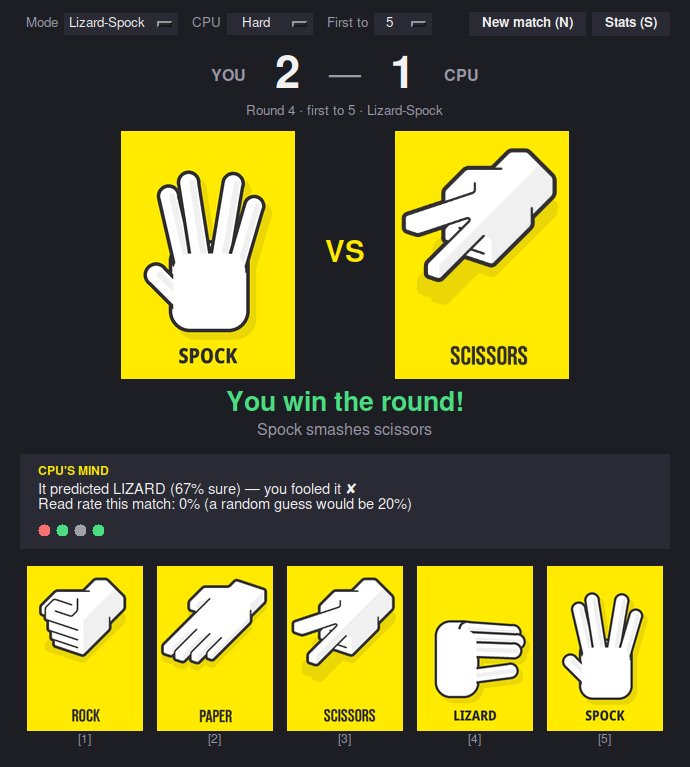
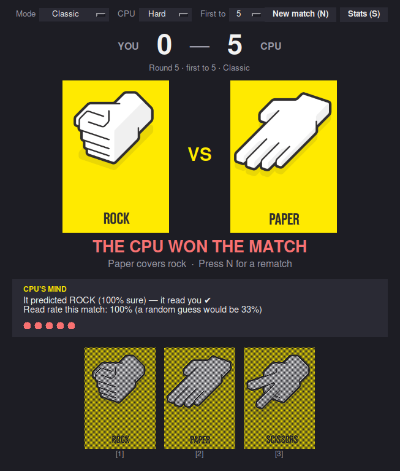
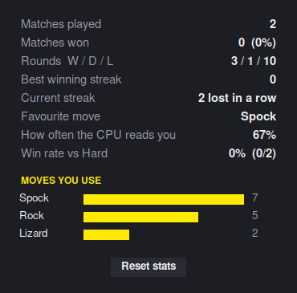

# Rock-Paper-Scissors

The same game, written twice, years apart. This repo keeps both versions so the difference is visible.

| | [v1](v1/) (2020) | [v2](v2/) |
|---|---|---|
| CPU | `random.choice` | Three difficulty levels; the hardest **learns your patterns** with Markov chains |
| Rules | Hand-written `if/else` for every move | Rules are **data**: adding Rock-Paper-Scissors-Lizard-Spock took a table, not code |
| Structure | One 118-line script | Package split into rules / AI / match / stats / GUI |
| Tests | None | 30+ pytest tests, run on Python 3.10–3.12 by GitHub Actions |
| Memory | Score lost when the window closes | Match history saved to JSON with win rate, streaks, favourite move |
| Feedback | "You win" / "You lose" | "Spock vaporizes rock", plus what the CPU *predicted* you would play |



## v2: a CPU that learns how you play

People are bad at being random. We avoid repeating moves, fall into cycles, or reach for a favourite move under pressure. The **Hard** CPU exploits that:

1. It keeps several Markov chains. Each one looks at your last *k* moves (k = 0 to 3) and counts what you played next. Counts slowly fade, so it adapts when you change strategy.
2. Each chain gets a score based on how well it predicted you recently. The CPU trusts the chain with the best score.
3. From the predicted probabilities it plays the move with the **best expected score**. This works the same with 3 or 5 moves.

The CPU always commits to its move **before** it sees yours. A test checks this.

📐 **[Architecture and algorithms](v2/docs/ARCHITECTURE.md)** has the module diagram, the life of a round, the math behind the predictions with a worked example, and the design decisions.

| CPU | How it decides |
|---|---|
| Easy | Pure chance. Nobody can beat it in the long run, and it can't beat you either. |
| Medium | Notices which moves you use most often. |
| Hard | Learns sequences too, e.g. "after rock, rock you usually play paper". |

The tests show the difference. Against a player who cycles rock → paper → scissors, Medium wins under 60% of rounds, because every move is used equally. Hard wins over 90%. Against a truly random player, no level gets an edge.

The **CPU's mind** panel shows its prediction every round, so you can try to fool it:



### Statistics

Every finished match is saved to `rps-arena/stats.json` inside `%APPDATA%` on Windows, `~/Library/Application Support` on macOS, or `~/.local/share` on Linux. The stats window shows your win rate, streaks, favourite move and how often the CPU reads you.



## Install and run

You need **Python 3.10 or newer**. The game only uses the standard library, so there's nothing to download besides Python itself.

**1. Get Python with Tkinter**

| System | What to do |
|---|---|
| Windows | Install from [python.org](https://www.python.org/downloads/). Keep **"tcl/tk and IDLE"** ticked (it is by default) and tick **"Add python.exe to PATH"**. |
| macOS | Install from [python.org](https://www.python.org/downloads/), which includes Tk. If you use Homebrew instead: `brew install python python-tk`. The `python3` that ships with Xcode is too old. |
| Linux | `sudo apt install python3-tk python3-venv` (Debian/Ubuntu) or your distro's equivalent. |

**2. Install the game** (from the repo folder)

Windows (PowerShell):

```powershell
cd v2
py -m venv .venv
.venv\Scripts\activate
pip install -r requirements.txt
rps
```

macOS / Linux:

```bash
cd v2
python3 -m venv .venv
source .venv/bin/activate
pip install -r requirements.txt
rps
```

`requirements.txt` installs the game itself and adds the `rps` command. If you'd rather not install anything, run `python -m rps` from inside `v2/`.

Controls: click a card or press `1`–`5`. `N` starts a new match and `S` opens your stats.

### Tests

```bash
pip install -r requirements-dev.txt
pytest
```

## Layout

```
v1/                 original 2020 version (single script)
v2/
  rps/
    rules.py        rulesets as data, outcome + "Paper covers rock" descriptions
    ai.py           Random / Adaptive / Markov opponents
    game.py         Match state: score, rounds, CPU read rate
    stats.py        JSON persistence (atomic writes) and summaries
    gui.py          Tkinter interface, the only module that touches Tk
    assets/         card art
  tests/            pytest suite (doesn't need Tk)
  docs/             screenshots and ARCHITECTURE.md
```

## About v1

`v1/` is kept as written in 2020, with two fixes so it still runs. Each button used to play a different move from its picture, and the image paths only worked on Windows.
