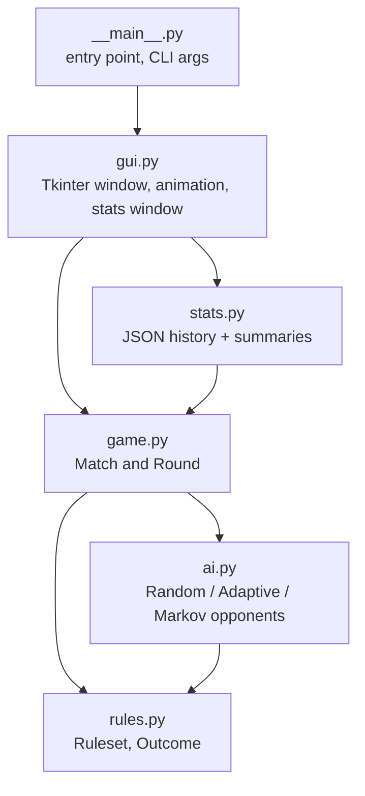
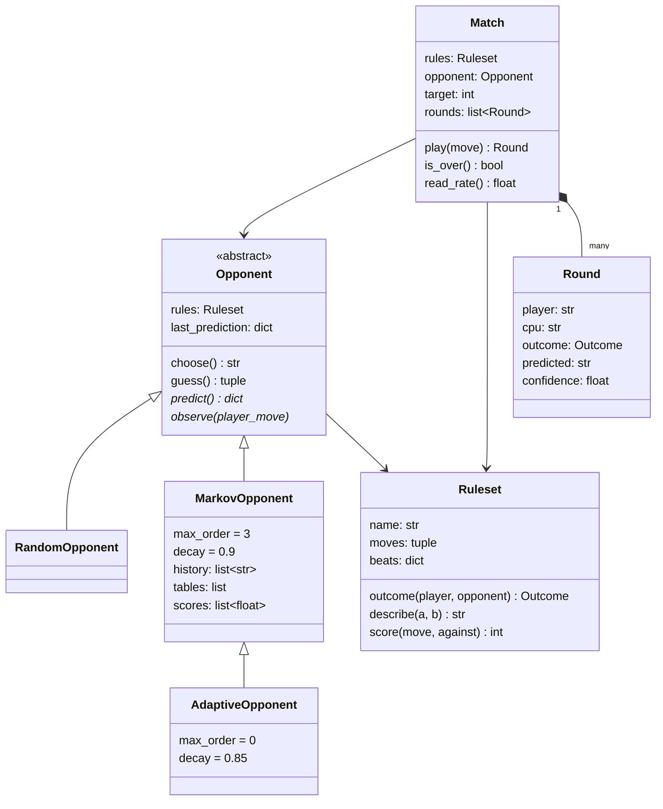
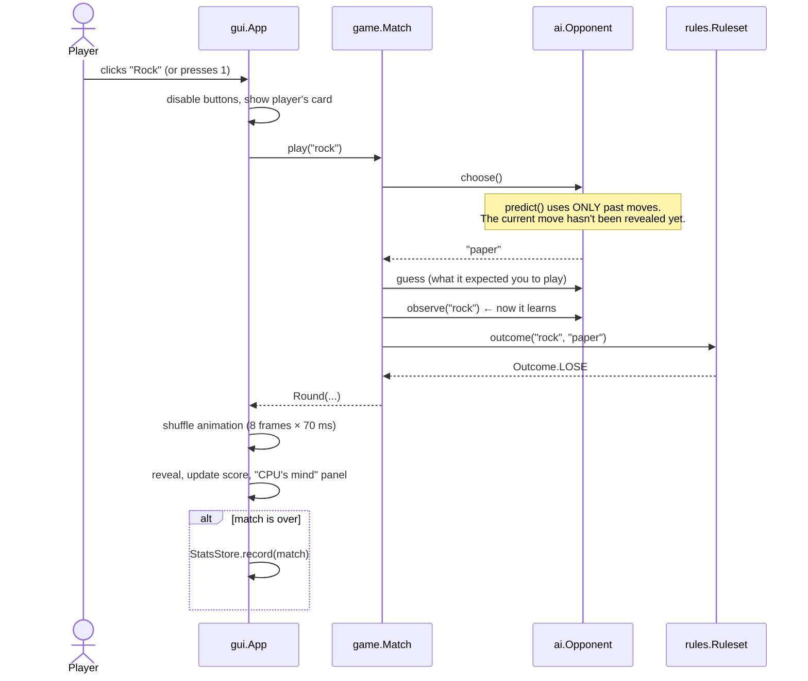
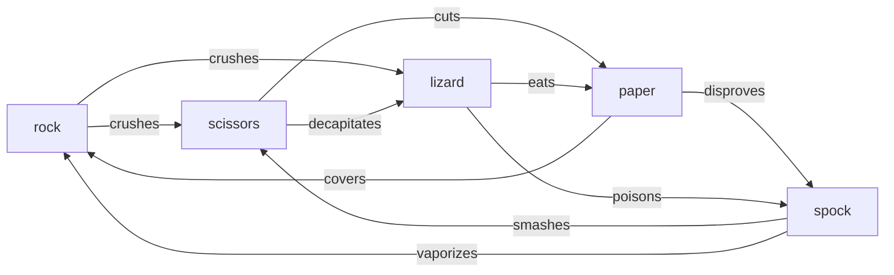

# Architecture and algorithms

This document explains how v2 is built and how its algorithms work. For installing and playing, see the [main README](../../README.md).

- [1. Architecture](#1-architecture)
- [2. Life of a round](#2-life-of-a-round)
- [3. Algorithms](#3-algorithms)
  - [3.1 Rules as a balanced tournament](#31-rules-as-a-balanced-tournament)
  - [3.2 Best response (expected value)](#32-best-response-expected-value)
  - [3.3 Markov chain prediction](#33-markov-chain-prediction)
  - [3.4 Choosing between chains](#34-choosing-between-chains)
  - [3.5 Forgetting old habits (exponential decay)](#35-forgetting-old-habits-exponential-decay)
  - [3.6 Worked example](#36-worked-example)
  - [3.7 Statistics](#37-statistics)
- [4. Design decisions](#4-design-decisions)
- [5. Testing strategy](#5-testing-strategy)
- [6. Ideas for the future](#6-ideas-for-the-future)

---

## 1. Architecture

The code is split into layers. Each layer only depends on the layers below it, and **only `gui.py` knows Tkinter exists**.



| Module | Responsibility | Main types |
|---|---|---|
| `rules.py` | What beats what, and the sentence that describes it ("Spock vaporizes rock"). Checks that a ruleset is fair. | `Ruleset`, `Outcome`, `CLASSIC`, `LIZARD_SPOCK` |
| `ai.py` | How the CPU predicts you and picks its move. | `Opponent` (abstract), `RandomOpponent`, `AdaptiveOpponent`, `MarkovOpponent`, `best_response()` |
| `game.py` | One match: plays rounds in the right order, keeps the score, knows when it's over. | `Match`, `Round` |
| `stats.py` | Saves finished matches and calculates statistics from them. | `StatsStore`, `Summary`, `summarize()` |
| `gui.py` | Draws everything and turns clicks and keys into `Match.play()` calls. Makes no game decisions. | `App` |
| `__main__.py` | Reads command-line options and explains how to get Tkinter if it's missing. | `main()` |

Because the logic doesn't import Tkinter, the whole test suite runs on machines without a display, including GitHub Actions.

### Class diagram



The **Strategy pattern** shows up here: `Match` works with any `Opponent`. Adding a new CPU means writing one class with `predict()` and `observe()`. Nothing else has to change.

---

## 2. Life of a round



**Fairness.** The CPU commits to its move inside `choose()`, before `observe()` gives it the player's move. The shuffle animation is only visual, because the result was already decided. The test `test_cpu_chooses_before_seeing_the_player_move` checks this order.

---

## 3. Algorithms

### 3.1 Rules as a balanced tournament

A ruleset is a **tournament graph**: each move is a node, and an arrow `a → b` means "a beats b".



For a game to be fair, no move can be better than another. `Ruleset._validate()` checks three rules when a ruleset is created:

1. The number of moves *n* is **odd**. With an even number, every move can't win and lose equally often.
2. Every move beats exactly **⌊n/2⌋** others. Mathematically, this is a *regular tournament*.
3. For every pair of different moves, **exactly one** beats the other. There are no ties between different moves and no contradictions.

Because the rules are data, `outcome()` is a single dictionary lookup instead of a chain of `if/else` statements. Adding the Lizard-Spock variant took a table with 10 entries.

### 3.2 Best response (expected value)

Every opponent separates two questions:

1. **What will the player play?** The answer is a probability distribution *P*, for example `{rock: 0.6, paper: 0.3, scissors: 0.1}`.
2. **Given that guess, what's my best move?**

For the second question, a win counts as +1, a loss as −1 and a draw as 0. The CPU calculates the **expected score** of each of its moves *m*:

$$EV(m) = \sum_{x} P(x) \cdot \text{score}(m, x)$$

It plays the move with the highest *EV*. If two moves tie, it picks one of them at random so it doesn't become predictable.

In the example above, *EV(paper)* = 0.6 − 0.1 = **0.5**, *EV(rock)* = 0.1 − 0.3 = −0.2, and *EV(scissors)* = 0.3 − 0.6 = −0.3, so the CPU plays **paper**.

This is better than "counter the most likely move". It weighs every possibility, and it works the same way with 3 or 5 moves. In Lizard-Spock, each move is beaten by two others, and *EV* chooses between them correctly.

If there's no prediction yet (the first rounds, or Easy mode), the CPU plays uniformly at random. That's the Nash equilibrium of the game: nobody can exploit it.

### 3.3 Markov chain prediction

A **Markov chain of order *k*** assumes your next move depends on your last *k* moves. For each *k*, the CPU keeps a table:

```
tables[k][ (last k moves) ][ next move ] = weighted count
```

| Order | Context it looks at | Pattern it can catch |
|---|---|---|
| 0 | nothing | "You like rock" (plain frequency) |
| 1 | last move | "After rock you usually play paper" |
| 2 | last 2 moves | "After rock, rock comes paper" |
| 3 | last 3 moves | Longer cycles and combos |

**Predicting** (`_predict_order`): take the last *k* moves, look up their row, and normalize the counts into probabilities. If that context has never happened, the chain has no opinion (`None`).

**Learning** (`observe`): for each *k*, update the row of the context that preceded the move you just played. The update is described in [3.5](#35-forgetting-old-habits-exponential-decay).

**Cost per round:** *O(K · n)*, where *K* = 4 chains and *n* = number of moves. Memory grows with the number of different contexts seen, at most *n^k* per chain, and in practice much less.

### 3.4 Choosing between chains

The chains often disagree. Short chains learn fast but miss sequences. Long chains spot sequences but need more data. Instead of fixing one, the Hard CPU keeps a **running score for each chain** and trusts the one predicting best right now. This is a simple version of the *ensemble / model selection* idea used in Rock-Paper-Scissors bot competitions.

After each round, every chain that made a prediction is scored:

$$\text{score}_k \leftarrow \delta \cdot \text{score}_k + \big(P_k(\text{actual move}) - \tfrac{1}{n}\big)$$

- `P_k(actual move)` is how much probability chain *k* gave to what you really played.
- Subtracting `1/n`, the chance of a random guess, means a chain only earns points when it does **better than chance**.
- `δ` (decay = 0.9) makes recent rounds count more than old ones.

When predicting, the CPU uses the chain with the highest score. Ties go to the **longer** chain, because it's more specific.

The **Medium** CPU is the same class with only order 0 (`AdaptiveOpponent(MarkovOpponent)` with `max_order=0`). The difference between Medium and Hard is a parameter, not duplicated code.

### 3.5 Forgetting old habits (exponential decay)

If counts only ever grew, a player who used rock for 30 rounds and then switched would stay labelled a "rock player" for a long time. So before adding the new observation, the counts in that row are multiplied by the decay:

```python
for m in counts:
    counts[m] *= decay      # 0.9 for Hard, 0.85 for Medium
counts[player_move] += 1
```

An observation from *t* updates ago weighs `decay^t`. With 0.9, a move from 10 updates ago counts about 35%, and one from 20 updates ago about 12%. The test `test_markov_adapts_when_the_player_changes_strategy` checks this. The player switches from rock to alternating Spock/lizard, and the CPU wins more than 80% of the last 30 rounds.

### 3.6 Worked example

The player has played `rock rock paper rock rock paper rock rock` and is about to play again. This is what the Hard CPU sees (real output from the code):

| Chain | Context | Prediction | Running score |
|---|---|---|---|
| order 0 | — | rock 75%, paper 25% | 1.17 |
| order 1 | `rock` | rock 60%, paper 40% | 0.62 |
| **order 2** | `rock rock` | **paper 100%** | **1.81** ← best |
| order 3 | `paper rock rock` | paper 100% | 1.27 |

Order 2 noticed that `rock rock` was followed by `paper` both times, and it has been the most accurate chain. The CPU predicts **paper**, so *EV* picks **scissors**.

A frequency-only CPU (Medium) would predict rock and play paper. Against the player's real paper, that's only a draw.

### 3.7 Statistics

**Read rate.** In each round, the CPU's prediction (`guess`) is stored next to what you actually played:

$$\text{read rate} = \frac{\text{rounds where predicted = played}}{\text{rounds with a prediction}}$$

The panel compares it to chance (33% in Classic, 20% in Lizard-Spock). Anything clearly above that means the CPU has found a pattern in your play.

**Streaks.** `summarize()` goes through the saved matches once, in order, with one counter: positive for a winning streak and negative for a losing streak. A win when the counter is positive adds 1; otherwise the counter resets to +1. Losses work the same way in the negative direction. The best streak is the highest value the counter reaches. This takes *O(matches)* time and *O(1)* extra memory.

**Safe saving.** `StatsStore` protects your history:

- **Atomic writes.** It writes to `stats.tmp`, then renames it over `stats.json`. A rename either happens completely or not at all, so a crash or power cut can't leave a half-written file.
- **Corrupt files are kept.** If the file can't be read, it's renamed to `stats.corrupt.json` and a new history starts. Data is never silently deleted.
- **Versioned format.** `"version": 1` in the file lets a future version detect old formats and migrate them.
- **Per-OS location.** `%APPDATA%` on Windows, `~/Library/Application Support` on macOS, and `$XDG_DATA_HOME` or `~/.local/share` on Linux.

---

## 4. Design decisions

| Decision | Why | Trade-off |
|---|---|---|
| Standard library only (Tkinter) | Installs anywhere with just Python. Nothing to break. | Tk looks less modern than Qt or a web UI. |
| Rules as data | New variants without new code. Fairness is checked automatically. | Slightly more abstract than plain `if/else` for a beginner reading it. |
| Opponents behind one interface | Easy, Medium and Hard are interchangeable, and new AIs plug in easily. | — |
| Medium = Markov of order 0 | One tested algorithm, two difficulty levels. | — |
| Several chains with self-scoring | Adapts to both simple players (spamming) and clever ones (cycles). | Needs a few rounds before it trusts any chain. |
| Decay instead of a fixed window | Constant memory per context, and it adapts smoothly. | Decay values were tuned by hand. |
| CPU decides before the animation | The shuffle can never "cheat", and the logic stays testable. | — |
| Only finished matches are saved | Statistics stay meaningful, because quitting halfway isn't counted as a loss. | Abandoning a losing match isn't recorded. |
| `random.Random` injected into opponents | Tests use fixed seeds and give the same result every run. | — |

---

## 5. Testing strategy

The tests are in `v2/tests/`. There are 32 of them, they take under a second, and they don't need Tkinter.

| File | What it proves |
|---|---|
| `test_rules.py` | Correct outcomes. Every move wins as often as it loses. Unfair or broken rulesets are rejected. Description sentences. |
| `test_ai.py` | Best response counters a certain guess. Medium exploits a favourite move. **Hard learns a cycle that Medium can't.** Hard adapts to a change of strategy. **No level has an edge against a truly random player.** |
| `test_game.py` | Scoring, end of match, invalid moves, the **choose-before-observe** order, and read rate. |
| `test_stats.py` | Save and reload. A corrupt file is backed up. Unfinished matches are not saved. Streak and rate calculations. |

The AI tests are **behavioural**. They don't check internal numbers. They play hundreds of rounds against scripted players and check win rates, for example "against rock → paper → scissors, Hard wins more than 90%". You can rewrite the algorithm freely, and the tests still check what matters.

GitHub Actions runs the tests on Ubuntu, Windows and macOS with Python 3.10 and 3.12.

---

## 6. Ideas for the future

- **Second-guessing.** Model the player who counters the CPU's last move. This is the "sicilian reasoning" behind the classic *Iocaine Powder* bot.
- **Online play.** The `Match`/`Opponent` split means a network player could be another `Opponent`.
- **Persist the CPU's memory** between matches, so the Hard CPU remembers you.
- **Tune decay automatically** by running several decays in parallel and letting the self-scoring pick one.
